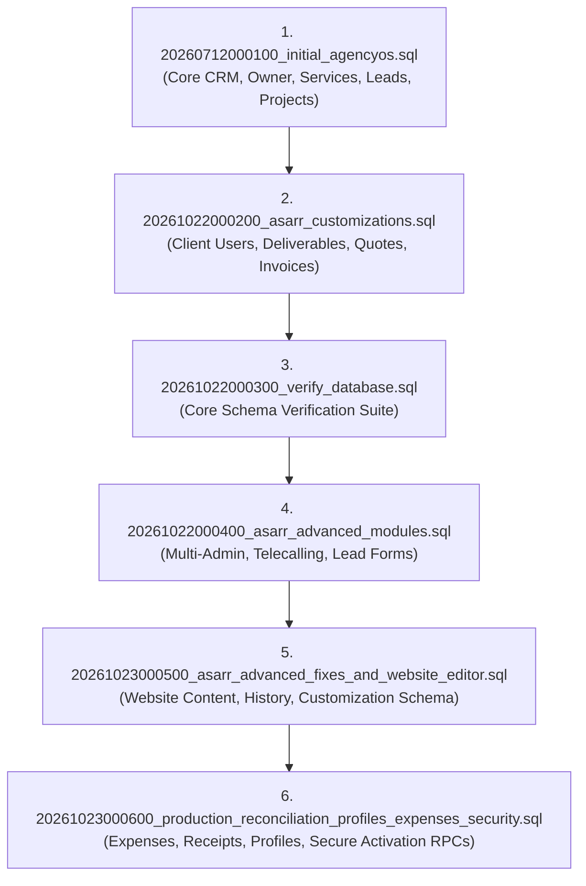

# ASARR AgencyOS & CRM — Supabase Backend Setup & Execution Guide

> **Version:** 2.0 Production Reconciliation  
> **Target Project:** `https://pftmtkryefpwsmdoutre.supabase.co`  
> **Audience:** Engineering, DevOps, and Database Administrators

---

## 1. Environment Configuration

The application reads configuration through environment variables. Ensure the following values are configured in your local and production environments:

### Root Next.js Application (`.env.local`)
```bash
NEXT_PUBLIC_SUPABASE_URL=https://pftmtkryefpwsmdoutre.supabase.co
NEXT_PUBLIC_SUPABASE_ANON_KEY=<your-anon-key>
# Optional Razorpay API Key for online client invoices:
NEXT_PUBLIC_RAZORPAY_KEY_ID=rzp_live_or_test_key
```

### ASAR CRM Application (`asarcrm/.env.local`)
```bash
VITE_SUPABASE_URL=https://pftmtkryefpwsmdoutre.supabase.co
VITE_SUPABASE_ANON_KEY=<your-anon-key>
# Optional:
VITE_RAZORPAY_KEY_ID=rzp_live_or_test_key
```

> **Security Rule:** Never put the `service_role` key into client-side environment files (`.env.local` or any frontend bundle). All client requests run strictly through the public `anon` key, authenticated via Supabase Auth JWTs, and authorized by PostgreSQL Row Level Security (RLS) and Security Definer RPC functions.

---

## 2. Complete SQL Migration Execution Order

Open your **Supabase Dashboard** -> **SQL Editor** -> **New Query**, and execute the migration files in this exact order:



---

### Step 1: Initial Core Schema & Base RLS
- **File**: `asarcrm/supabase/migrations/20260712000100_initial_agencyos.sql`
- **Scope**:
  - Initializes `pgcrypto` extension.
  - Creates single-owner `installation_settings`.
  - Creates core tables: `profiles`, `clients`, `services`, `leads`, `lead_services`, `projects`, `project_images`, `tasks`, `events`, `invoices`, `forms`, `templates`, `proposals`, `client_activity`, `notifications`, `portfolio_views`.
  - Sets up security functions: `installation_owner_id()`, `is_installation_owner()`, `is_installation_lead()`.
  - Creates public storage buckets: `brand-assets`, `project-images`, `lead-attachments`.
  - Enables RLS across all core tables and storage objects.

---

### Step 2: Client Portal Infrastructure & Customizations
- **File**: `asarcrm/supabase/migrations/20261022000200_asarr_customizations.sql`
- **Scope**:
  - Creates `client_users` membership table linking authenticated Supabase users to client organizations.
  - Creates `project_milestones` and `project_deliverables` for asset reviews and approvals.
  - Creates `quotation_versions` with line items, tax calculations, and client approval/rejection audit trails.
  - Creates `support_tickets` and `invoice_payments` (Razorpay support).
  - Installs security helper `client_user_client_id()` to enforce tenant isolation.
  - Creates private storage buckets: `client-deliverables` (100MB limit) and `client-documents` (50MB limit) with scoped Storage RLS policies.
  - Seeds official ASARR digital service offerings upon owner activation.

---

### Step 3: Verification Script (Phase 1 Baseline)
- **File**: `asarcrm/supabase/migrations/20261022000300_verify_database.sql`
- **Scope**:
  - Confirms baseline tables, RLS enablement, and security helper functions.

---

### Step 4: Advanced Modules (Multi-Admin, Telecalling, Client Onboarding)
- **File**: `asarcrm/supabase/migrations/20261022000400_asarr_advanced_modules.sql`
- **Scope**:
  - Multi-Admin Management: `admin_memberships` (`owner`, `admin`, `team_member`) and `admin_invitations`.
  - Client Onboarding: `client_onboarding_invitations`.
  - UI Preferences: `user_ui_preferences`.
  - Lead Forms & Submissions: `form_submissions`.
  - Tele-Calling CRM: `telecalling_niches`, `telecalling_campaigns`, `telecalling_contacts`, `telecalling_call_logs`, `telecalling_follow_ups`.
  - Installs security helpers: `is_admin()`, `is_team_member()`.

---

### Step 5: Website Content Editor & Publishing Schema
- **File**: `asarcrm/supabase/migrations/20261023000500_asarr_advanced_fixes_and_website_editor.sql`
- **Scope**:
  - Creates `website_content` with draft and published rows (`id = 'draft'`, `id = 'published'`).
  - Creates `website_content_history` for versioned audit trail snapshots.
  - Configures RLS: public read access granted only to `id = 'published'`; authenticated admins retain full read/write management.

---

### Step 6: CRITICAL Production Reconciliation, Profiles, Expenses & Security Definer RPCs
- **File**: `asarcrm/supabase/migrations/20261023000600_production_reconciliation_profiles_expenses_security.sql`
- **Scope**:
  - **Profiles Reconciled:** Adds `phone`, `designation`, `department`, `timezone`, `preferences` to `profiles`.
  - **Clients Reconciled:** Adds `website`, `logo_url`, `brand_name`, `contact_name` to `clients`.
  - **Client Onboarding Reconciled:** Adds `full_name`, `phone`, `client_name` to `client_onboarding_invitations`.
  - **Admin Memberships Reconciled:** Adds `email` column to `admin_memberships` with auto-sync from `profiles` and `auth.users`.
  - **Tasks & Projects Reconciled:** Adds `assigned_to`, `assigned_to_email` to `tasks`; adds `budget`, `end_date` to `projects`.
  - **Invoices Reconciled:** Adds `invoice_number`, `total`, `amount_paid`, `balance` to `invoices`.
  - **Form Submissions Reconciled:** Adds `form_title`, `submitter_name`, `submitter_email`, `submitter_phone` to `form_submissions`.
  - **Website Content Reconciled:** Adds `selected_work_meta`, `philosophy`, `process` to `website_content` and `website_content_history`.
  - **Team Expense Module:**
    - Creates `expenses` table with full categories (`software_subscription`, `travel_transit`, `office_supplies`, `meals_entertainment`, `contractor_freelance`, `hardware_equipment`, `advertising_marketing`, etc.).
    - Creates `expense_receipts` table.
    - Creates sequence `expense_reference_seq` with automated trigger generating reference codes (`EXP-YYYYMM-0001`).
    - Creates private storage bucket `expense-receipts` (15MB limit, PDF & Images).
    - Installs RLS policies: Team members submit and view own expenses; Admins review, approve, reject, or mark reimbursed; **Clients strictly denied all access**.
  - **Security Definer Activation RPCs:**
    - `claim_client_invitation(token, full_name, phone)`: Validates invitation token, verifies status is `pending` or `sent`, verifies expiry, binds authenticated user ID to the pre-authorized `client_id`, updates profile, and sets invitation status to `accepted`.
    - `claim_admin_invitation(token, full_name)`: Validates invitation token, assigns the exact pre-approved role (`admin` or `team_member`), records membership in `admin_memberships`, updates profile, and consumes token.
  - **Installation Owner Sync:** Confirms owner `77308899-8657-4ce4-907c-b56e33c8f760` (`syed.ae018@asarr.in`) in `installation_settings` and `admin_memberships`.

---

## 3. Required Supabase Dashboard Configuration

### Authentication Settings
1. Navigate to **Authentication** -> **Configuration** -> **Sign In / Up**:
   - **Allow new users to sign up**: Keep enabled, BUT public self-registration is gatekept by the application: users who create an account without an invitation token have no membership in `admin_memberships` or `client_users` and are blocked at login.
2. Navigate to **Authentication** -> **URL Configuration**:
   - **Site URL**: `https://asarr.in` (or `http://localhost:3000` during development).
   - **Redirect URLs**:
     - `http://localhost:3000/**`
     - `http://localhost:3000/portal/**`
     - `http://localhost:3000/portal/auth`
     - `https://asarr.in/**`
     - `https://asarr.in/portal/**`
     - `https://asarr.in/portal/auth`
3. Navigate to **Authentication** -> **Email**:
   - Configure your custom SMTP provider (e.g. AWS SES, SendGrid, Resend, or Google Workspace SMTP) for production invitation and password recovery emails.

---

## 4. Key Workflows & Operational Runbook

### A. Invitation-Only Client Onboarding
1. Go to `/onboarding` in the Admin Dashboard.
2. Click **Invite Client**.
3. Enter Client Full Name, Business Name, Authorized Email, and Mobile Phone.
4. Select the corresponding client organization.
5. Click **Create & Generate Link**.
6. Share the link with the client: `https://asarr.in/portal/auth?tab=activate&token=<token>`.
7. Client opens link -> Enters full name, phone, and sets password -> System executes `claim_client_invitation` RPC -> Client account is activated and redirected to their secure portal.

### B. Invitation-Only Admin Team Onboarding
1. Go to `/team` in the Admin Dashboard.
2. Click **Invite Team Member**.
3. Enter Email Address and select Role (`admin` or `team_member`).
4. Click **Generate Invite**.
5. Copy the invite link: `https://asarr.in/portal/auth?tab=activate&token=<token>&type=admin`.
6. Recipient opens link -> Sets password -> System executes `claim_admin_invitation` RPC -> Account activated and routed to `/` (Admin Dashboard).

### C. Admin & Client Profile Self-Service
- **Admins:** Open `/settings` -> Click **My Profile** tab. Update avatar, mobile number, job title, department, and timezone. Change password in the **Security & Credentials** section.
- **Clients:** Open `/portal/profile` in the Client Portal. Update contact name, brand website, physical address, and brand logo. Change password with real-time feedback.

### D. Team Expenses & Printable Vouchers
1. Go to `/expenses` in the Admin Dashboard.
2. Click **Add Expense**. Enter title, amount, category, payment method, date, and upload receipt document.
3. Review status in the responsive table. Filter by Category, Status, or Date range.
4. **Approval Workflow:** Authorized Admins/Owners review submitted expenses, and approve, reject, or mark as reimbursed with reviewer timestamps.
5. **Print Voucher:** Click the **Printer** icon on any expense row to open `/expenses/:id/print`. Displays clean A4 voucher with agency details, reference number (`EXP-YYYYMM-XXXX`), breakdown, approval audit block, and receipt preview. Press **Print / Save PDF**.

### E. Website & Portfolio Customization Publishing
1. Go to `/portfolio` in the Admin Dashboard.
2. Edit hero copy, value propositions, service pillars, project showcases, brand colors, and CTA copy.
3. Click **Save Draft** to store changes in Supabase (`website_content` row `id = 'draft'`).
4. Click **Publish Changes** to promote changes live (`website_content` row `id = 'published'`). The Next.js marketing site instantly consumes published changes via real-time hooks and CSS token injection.

---

## 5. Rollback Strategy

All changes in Migration 6 are non-destructive and backward compatible:
- No existing tables were dropped or renamed.
- No existing columns were dropped or altered in a breaking way.
- New tables (`expenses`, `expense_receipts`) and added columns can be inspected without affecting existing queries.

If rollback of Migration 6 is ever required:
```sql
-- Rollback Migration 6 (Only if explicitly instructed)
drop table if exists public.expense_receipts cascade;
drop table if exists public.expenses cascade;
drop sequence if exists public.expense_reference_seq;
drop function if exists public.claim_client_invitation;
drop function if exists public.claim_admin_invitation;
drop function if exists public.generate_expense_reference;
```
